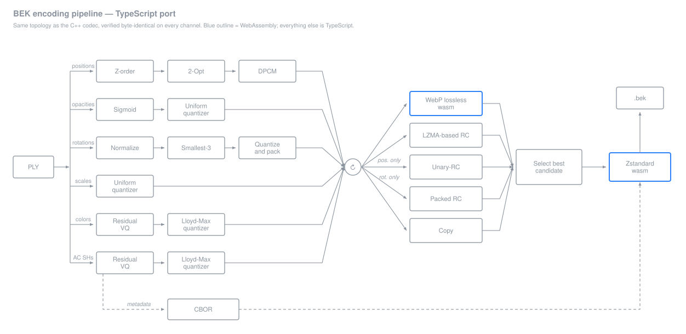
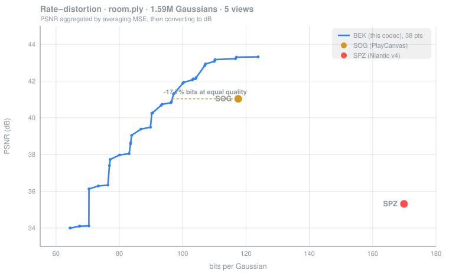

# BEK Online Coder

A **TypeScript conversion of the [BEK](https://github.com/sebastianobecchetti/bek) C++ codec**
for 3D Gaussian Splatting compression, running entirely in the browser:
encodes a `.ply` scene into the compact `.bek` container, or decodes a
`.bek` back to `.ply`. Nothing is uploaded anywhere &mdash; the file is
read, processed, and offered for download without ever leaving the tab.
Direction is detected from the file's own bytes, not its name.

Live page: [sebastianobecchetti.github.io/bek_online_coder](https://sebastianobecchetti.github.io/bek_online_coder/).
GitHub Pages for this repo is configured to serve straight from the `main`
branch's root, not from an Actions-built artifact &mdash; so `main.js`,
`worker.js`, and `vendor/` are committed build output, not `.gitignore`d.
Run `npm run build` and commit the result after any source change; CI
(`.github/workflows/ci.yml`) fails the build if that would produce something
broken, and `npm run verify` (see below) catches a committed bundle that's
gone stale relative to its own sources.

## Related repositories

- **[bek](https://github.com/sebastianobecchetti/bek)** &mdash; the reference C++ codec (`ply_to_bek` / `bek_to_ply`),
  the parameter sweep harness and the BEK Simulation Studio GUI. Every claim of
  byte-level parity on this page is parity against that implementation.
- `bek-ts`, the Node port whose sources this repo vendors under
  `vendor/bek-ts/`, is not published as a repository of its own: the copy here
  is the public one. References to `../bek-ts` throughout this file mean a local
  sibling checkout used during development.

## Datasets

All simulations and measurements reported here were run on the scenes
distributed with
**[graphdeco-inria/gaussian-splatting](https://github.com/graphdeco-inria/gaussian-splatting)**.
The scenes are not redistributed in this repository.

## What this is

A static-site wrapper around `bek-ts`, a TypeScript/Node port of
the BEK codec (encode: `.ply` &rarr; `.bek`; decode: `.bek` &rarr; `.ply`),
itself a from-scratch conversion of the production C++ codec
([`bek`](https://github.com/sebastianobecchetti/bek)), with two Node-only pieces replaced so it can run
in a browser tab:

- **WebP.** `bek-ts` shells out to Homebrew's `cwebp`/`dwebp`. This project
  instead uses a vendored WebAssembly build of libwebp from
  [PlayCanvas `splat-transform`](https://github.com/playcanvas/splat-transform)
  (`vendor/webp.wasm` + `vendor/webp.mjs`, MIT license, Copyright PlayCanvas)
  and calls `webp_encode_lossless_rgba` / `webp_decode_rgba` directly
  &mdash; encode verified byte-identical to the C++ reference's
  `cwebp -lossless -m 4 -q 100 -exact` output (see `scripts/verify-node-entry.ts`).
  `splat-transform` is also the tool used to produce the SOG/SPZ comparison
  points below; this project only reuses its WebP wasm build, and is not
  affiliated with or endorsed by PlayCanvas.
- **zstd.** `bek-ts` uses `node:zlib`'s zstd bindings, which don't exist in a
  browser. This project uses real zstd in WebAssembly via
  [`@bokuweb/zstd-wasm`](https://github.com/bokuweb/zstd-wasm) 0.0.27 (MIT),
  vendored as a prebuilt single-file bundle + its `.wasm`
  (`vendor/zstd/zstd-wasm.mjs` + `vendor/zstd/zstd.wasm` &mdash; the npm
  package itself is a devDependency only, used to produce those two files,
  never a runtime dependency of the page). Compresses at level 22, same as
  `bek-ts`'s own Node pipeline. An earlier version of this shim
  (`zstd-raw.ts`, since deleted) wrote raw, uncompressed zstd blocks instead
  of really compressing &mdash; correct, but ~14% bigger on small scenes.

Neither of these touches `bek-ts`'s source. Both are swapped in with an
esbuild `onResolve` alias (`esbuild-alias-plugin.mjs`) that redirects
`./webp.ts` &rarr; `src/webp-wasm.ts` and `node:zlib` &rarr; `src/zstd-wasm.ts`
only when imported from the vendored codec files. A third alias
(`./order.ts` / `./rvq.ts` &rarr; `src/order-progress.ts` / `src/rvq-progress.ts`)
adds progress-reporting hooks around the sort and RVQ (k-means) stages, since
those dominate encode time and the UI needs to show real phase progress
without a modified, un-verifiable copy of the codec.

`vendor/bek-ts/` is a frozen, unmodified copy of the `bek-ts` source files
this project actually imports (`encode.ts`, `decode.ts`, `container.ts`,
`cbor.ts`, `order.ts`, `quantize.ts`, `rangecoder.ts`, `rvq.ts`) &mdash;
vendored because GitHub Actions can't reach the sibling `../bek-ts` checkout
this was developed against. Run `scripts/sync-codec.sh` to refresh it (and
its manifest, `vendor/bek-ts/manifest.json`) from `../bek-ts` when that
project changes; nothing in this repo edits those files.

## Pipeline



Each group of PLY attributes takes its own quantization path; every channel
is then coded with whichever lossless candidate comes out smallest (WebP,
LZMA-style range coder, Unary-RC/*posmag* for positions, Packed-RC/*rotpack*
for rotations, or a raw copy). Metadata is serialized as CBOR and the whole
container is compressed with Zstandard into the `.bek` stream.

This is the same topology as the C++ codec, box for box &mdash; the port
reproduces it byte-identically (see [Equivalence guarantee](#equivalence-guarantee)).
Only two boxes differ in *implementation*: WebP and Zstandard run as
WebAssembly here instead of linking native libwebp and libzstd. Decoding is
the same graph in reverse, and is also byte-exact against the C++ decoder.
Regenerate the figure with `python3 scripts/make-pipeline-figure.py`.

## Rate-distortion



All numbers below are measured on `room.ply` (1.59M Gaussians), the same 5
render views, PSNR aggregated by averaging MSE and then converting to dB
(never by averaging dB values). Sources, in [`bek`](https://github.com/sebastianobecchetti/bek):
`room_sweep.csv` (BEK, 216 swept configurations, Pareto frontier extracted
from it), `room_sog.csv`, `room_spz_real.csv` (SOG and SPZ measured with the
same render harness and the same 5 views, via `@playcanvas/splat-transform`
writing real SOG and real SPZ v4).

| codec | size | bits/Gaussian | PSNR | SSIM |
|---|---|---|---|---|
| BEK &mdash; Pareto frontier, 38 points | 12.24&ndash;23.52 MB | 64.42&ndash;123.82 | 34.00&ndash;43.32 dB | &mdash; |
| SOG (PlayCanvas splat-transform) | 22.33 MB | 117.56 | 41.03 dB | 0.9903 |
| SPZ (Niantic v4, via splat-transform) | 32.27 MB | 169.89 | 35.31 dB | 0.9768 |

Reading the BEK frontier against each point (linear interpolation between
the two nearest measured frontier points, no extrapolation):

- **vs. SOG:** at SOG's quality (41.03 dB), the BEK frontier reaches it at
  96.71 bits/Gaussian vs. SOG's 117.56 &mdash; 17.7% fewer bits for the same
  PSNR. At SOG's bitrate (117.56 bits/Gaussian), the frontier reaches 43.30 dB
  vs. SOG's 41.03 &mdash; +2.27 dB at the same rate.
- **vs. SPZ:** at SPZ's quality (35.31 dB), the BEK frontier reaches it at
  70.40 bits/Gaussian vs. SPZ's 169.89 &mdash; 58.6% fewer bits for the same
  PSNR. SPZ's bitrate (169.89) is above the highest point measured on the
  BEK frontier (123.82), so no same-bitrate comparison is made there &mdash;
  extrapolating past the measured frontier isn't a real number.

This is the C++/TypeScript-port codec's own frontier, not a claim specific
to this browser build; the browser encoder reproduces it exactly at the
default operating point (see "Equivalence guarantee"). The `.bek` this
page's default settings produce on `room.ply` is byte-identical in its
pre-zstd form to the twin C++ output (15.87 MB / 83.57 bpg C++ vs. 15.89 MB
/ 83.67 bpg here; the small difference is single- vs. multi-threaded zstd
framing, not codec output).

## Build

```bash
npm install
npm run build       # esbuild -> repo root: main.js, worker.js (index.html, style.css, vendor/ already live there)
```

Serve the repo root with any static file server to try it locally, e.g.
`python3 -m http.server 8080`.

## Equivalence guarantee

The concrete risk for a project like this is vendoring drift: nothing stops
`vendor/bek-ts/src/*` (a manual copy of `../bek-ts/src/*`) from silently
going stale, or the committed `main.js`/`worker.js` from not actually
matching what's in `src/`. `npm run verify` runs four checks, each closing
one link in that chain:

1. **Ring 1 &mdash; vendoring isn't stale** (`npm run verify:vendor`).
   `vendor/bek-ts/manifest.json` records the sha256 of every vendored file,
   regenerated by `scripts/sync-codec.sh`. Verify fails if the vendored
   files don't match their own manifest (hand-edited or manifest not
   regenerated), and &mdash; only when `../bek-ts` is reachable, i.e. never
   in CI &mdash; also fails if they differ from the live `../bek-ts/src`.
   CI runs the manifest-only half and says so.

2. **Ring 2 &mdash; numeric equivalence with the C++ codec, encode
   direction** (`npm run verify:equivalence`, local only, needs `../bek-ts`
   and a local C++ build). Bundles the exact browser encode path (wasm-webp
   + wasm-zstd) for Node and: (a) checks the pre-zstd uncompressed buffer for
   `bek-ts/data/tiny.ply` is byte-identical to `bek-ts/test/ref_tiny_strict.raw`
   (the existing, already-verified reference for the strict-IEEE pipeline);
   (b) decodes the resulting `.bek` with the real C++ `build/bek_to_ply` and
   diffs the output PLY, byte-for-byte, against `bek_to_ply` decoding a
   reference `.bek` built by `bek-ts`'s own CLI (real `cwebp` + real
   `node:zlib` zstd &mdash; the pipeline `bek-ts/README.md` already documents
   as L1-equivalent to the C++ encoder).

3. **Ring 3 &mdash; the shipped bundle is the verified one**
   (`npm run verify:bundle`). Rebuilds `main.js`/`worker.js` from the exact
   sources on disk right now (same esbuild options as the real build, shared
   via `scripts/build-site.mjs`) into a scratch directory and diffs them
   byte-for-byte against the committed root `main.js`/`worker.js`. esbuild's
   output is deterministic for identical inputs, so any mismatch means the
   committed bundle wasn't built from what's currently in `src/`.

4. **Ring 4 &mdash; numeric equivalence with the C++ codec, decode
   direction** (also part of `verify:equivalence`, same local-only
   requirements). Takes a `.bek` produced by the real C++ encoder
   (`build/ply_to_bek` on `bek-ts/data/tiny.ply`), decodes it with this
   project's own browser code path (`vendor/bek-ts/src/decode.ts` + wasm-webp
   decode + wasm-zstd decode), and diffs the resulting `.ply`, byte-for-byte,
   against `build/bek_to_ply` decoding that exact same `.bek`. No tolerance
   here: decode never re-runs k-means, so there's no `-ffast-math` rounding
   question to account for &mdash; either the bytes match or there's a bug.

Rings 2 and 4 need both sibling repos and the C++ binaries, so they're the
ones that only run locally; CI prints an explicit skip line rather than
pretending to pass them.

**What is *not* verified**: the final `.bek`'s compressed bytes are not
byte-identical to the C++ reference's, and structurally can't be &mdash; the
C++ encoder sets `ZSTD_c_nbWorkers = hardware_concurrency()` (multi-threaded
zstd), which its own source comment documents as non-reproducible even
against itself across machines. This project's zstd call is single-threaded
and deterministic, but at a different point in the same non-uniqueness space.
The guarantee that matters is the one Anelli 2 and 4 actually check: the
decoded PLY is byte-identical in both directions, so the `.bek` this page
produces decodes to exactly the same scene the C++ codec would have
produced, and a `.bek` the C++ codec produces decodes here to exactly the
same `.ply` `bek_to_ply` would give.

```bash
npm run verify       # runs all four rings in order
```

## Parameters

The page starts from the codec's default operating point (`dc_stages=2`,
`sh_stages=3`, `pos_bits=9`, `vq_iters=30`, `sort_refine=128`,
`rot_mag_bits=6`). The collapsible "Advanced parameters" section exposes
exactly the flags `bek-ts/src/cli.ts` implements for the encode path
(`--dc-stages`, `--sh-stages`, `--pos-bits`, `--vq-iters`, `--sort-refine`,
`--rot-mag-bits`) &mdash; nothing invented beyond what the codec accepts.
Decoding has no parameters.

## Performance and limits

- **Encoding** is CPU-bound, single-threaded, and dominated by RVQ (k-means)
  training. Measured: ~300s for `room.ply` (1.59M splats) in this browser
  pipeline, vs. ~10s for the same scene with the native C++ encoder &mdash;
  that gap is the price of running entirely client-side instead of as
  compiled, multi-threaded native code. It all runs in a Web Worker so the
  tab stays responsive.
- **Decoding** is fast: no k-means. ~4s for a 1.6M-splat `.bek` in this
  pipeline.
- **Memory, not time, is the real constraint on decode.** A `.ply` is
  written as 32-bit floats for every property, uncompressed &mdash; the
  decoded file is typically 15&ndash;25&times; the size of the source `.bek`
  (scene-dependent), and the whole thing is materialized in memory before
  it's offered as a download. There's no streaming decode; very large
  `.bek` files can exhaust a browser tab's memory before the download link
  ever appears.
- Nothing is uploaded to a server in either direction; there is no server.

## License

MIT &mdash; see [`LICENSE`](LICENSE). Vendored third-party WebAssembly
(libwebp via PlayCanvas splat-transform, zstd via @bokuweb/zstd-wasm) keeps
its own upstream license terms; see [`THIRD-PARTY-NOTICES.md`](THIRD-PARTY-NOTICES.md)
for the full texts and attributions.
